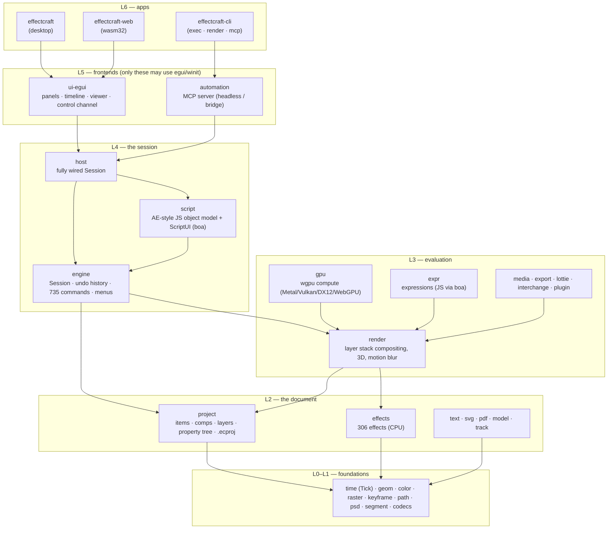
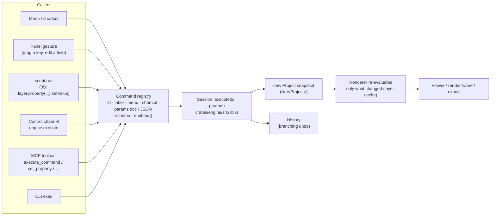
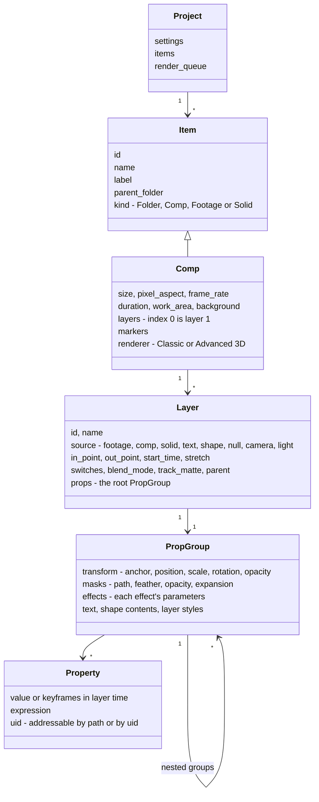
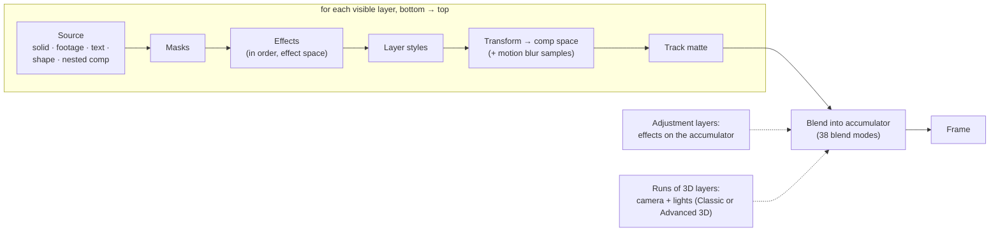
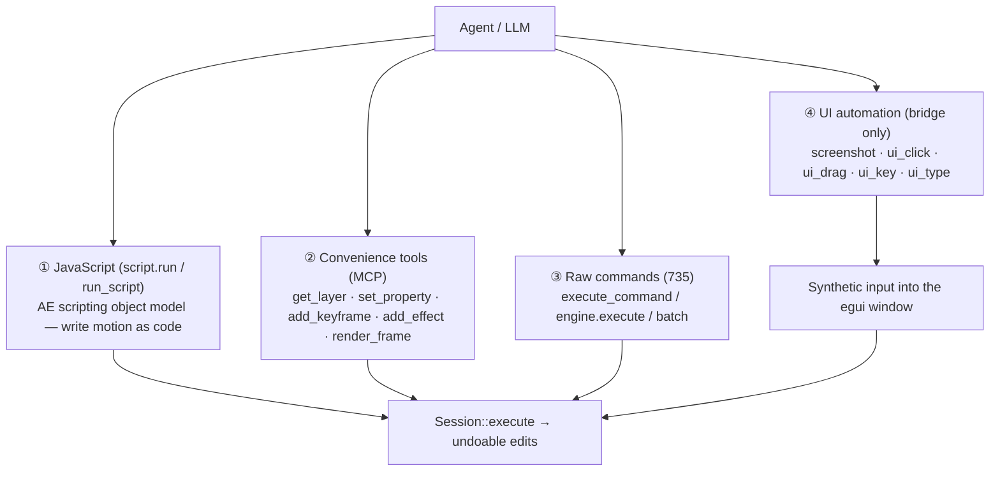

# EffectCraft: how it works, how to run it, and what an agent can do

Fork notes for the "Cursor for After Effects" project. These notes are ours, not upstream's,
so they live in `notes/`, which upstream doesn't touch, to keep merges clean.
Checked against upstream `c6184292` (EffectCraft 0.17.0) on 2026-10-26.

Contents:
1. [Basic usage](#1-basic-usage)
2. [How the codebase works](#2-how-the-codebase-works)
3. [What an agent can call and do](#3-what-an-agent-can-call-and-do)
4. [Implications for the agent app](#4-implications-for-the-agent-app)

---

## 1. Basic usage

### One-time setup

```sh
curl --proto '=https' --tlsv1.2 -sSf https://sh.rustup.rs | sh -s -- -y   # Rust (needs 1.95+)
. "$HOME/.cargo/env"                                                     # or open a new terminal
```

### Build and run

```sh
cargo build -p effectcraft -p effectcraft-cli         # first build ~1.5 min on an M5 Pro
cargo run -p effectcraft -- --control 9877            # desktop app + JSON control server
```

- The dev profile already optimizes the pixel-heavy crates (`raster`, `render`, `gpu`,
  `effects`…), so debug builds are responsive. You rarely need `--release` for the app.
- **Edit, then see the change:** edit Rust code, quit the app, and run `cargo run …` again.
  Only changed crates rebuild.
- **Screenshot without a window**, which works while you use the machine:
  `cargo run -p effectcraft-ui-egui --example snapshot -- --out ui.png --step '<control request>'`
- **Quality gate** before a commit: `cargo xtask ci` (fmt, clippy, tests, layering, assets, wasm).

### Drive the running app

The control channel is TCP on `127.0.0.1:9877`, carrying one JSON object per line. It has
no authentication, so only enable it while you use it. A tiny client lives in
[`tools/ec.py`](tools/ec.py):

```sh
python3 notes/tools/ec.py engine.execute '{"command":"project.summary"}'
python3 notes/tools/ec.py engine.execute '{"command":"layer.newText","params":{"text":"Hi"}}'
python3 notes/tools/ec.py render.frame '{"time":1.0,"max_side":640,"path":"/tmp/f.png"}'
python3 notes/tools/ec.py ui.screenshot '{"path":"/tmp/ui.png"}'
```

Running a JavaScript file, here the demo in [`tools/demo.js`](tools/demo.js):

```sh
python3 -c 'import sys,json; sys.path.insert(0,"notes/tools"); from ec import call; \
  print(call("engine.execute",{"command":"script.run","params":{"code":open("notes/tools/demo.js").read()}}))'
```

`demo.js` creates a comp, adds a solid and a text layer, keys a slide-up and a fade-in, and
puts `wiggle(2, 4)` on the rotation. It's one undoable script, and the result appears live
in the window.

### Other ways in

| Interface | Command | Needs the window |
|---|---|---|
| CLI | `effectcraft-cli exec/get/set/render/script … --json` | no |
| MCP (headless) | `effectcraft-cli mcp --demo` | no |
| MCP (bridged to the app) | `effectcraft-cli mcp --bridge 9877` | yes |

The repo's [`.mcp.json`](../.mcp.json) registers both MCP servers for Claude Code. They use
`cargo run --release`, so run `cargo build --release -p effectcraft-cli` once first, or the
first start times out.

---

## 2. How the codebase works

About 405k lines of Rust in about 35 crates under `crates/`, plus three apps under `apps/`.
There are three ideas to keep in mind:

1. **Strict layers.** A crate may only depend on lower layers. `cargo xtask layers` enforces
   this, and nothing below L5 may touch UI libraries, so L0–L4 also build for the browser
   (WASM).
2. **Everything is a command.** Every action (menu item, shortcut, drag, script edit, agent
   call) becomes a named command with JSON params, executed by one `Session`.
3. **Everything animatable is a property** in a tree, addressed by a path such as
   `transform/position` or `effects/#1/blurriness`.

### 2.1 Layer diagram



| Layer | Crates | What lives there |
|---|---|---|
| L0 | `time`, `geom`, `color`, `vp9enc`, `opusenc`, `hevcenc`, `av1enc` | Exact time (`Tick` = 1/254 016 000 000 s), vectors and transforms, color and blend modes, video and audio encoders |
| L1 | `raster`, `keyframe`, `path`, `psd`, `segment` | Float images and blurs, keyframe interpolation and eases, Bezier paths, PSD reader, ML models (Roto Brush, face) |
| L2 | `project`, `effects`, `text`, `svg`, `pdf`, `model`, `track` | **The document model**, the effect registry, text shaping, vector import, 3D models, motion tracking |
| L3 | `render`, `gpu`, `expr`, `media`, `export`, `lottie`, `interchange`, `plugin` | Rendering a frame, the GPU compositor, expressions, decoding and encoding footage, Lottie, WASM effect plug-ins |
| L4 | `engine`, `script`, `host` | **`Session` + command registry + undo**, JavaScript scripting, wiring |
| L5 | `ui-egui`, `automation` | Desktop UI (egui) with the control server, MCP server |
| L6 | `apps/*` | Executables |

### 2.2 The command funnel: every way in goes through one function



What this means in practice:

- **A command definition** looks like this (`crates/engine/src/commands/layer.rs`):
  ```rust
  cmd!("layer.select", "Select Layers", [], None,
       "{layers: [id|name|#n], add?, toggle?}", has_comp, select)
  //   id            label            menu  shortcut  params doc   enabled()  run()
  ```
- **The UI holds the session.** `EffectcraftApp` (`crates/ui-egui/src/lib.rs`) owns
  `session: Session` plus serializable `ui: UiState`. The UI never edits the project
  directly; it calls commands.
- **Control requests run on the UI thread between frames.** `crates/ui-egui/src/control.rs`
  `handle()` routes `engine.execute` to the registry, and `ui.*` methods to synthetic input
  or inspection.
- **Scripts don't bypass the engine either.** The JS object model in `crates/script` turns
  `prop.setValueAtTime(...)` into engine commands, so script edits are undoable and appear
  live.
- **Headless works the same.** The MCP server and the CLI build a `Session` through `host`
  with no window at all.

### 2.3 Document model



- **Projects are readable JSON** (`.ecproj`), versioned by a `schema` number and upgraded on
  open. That's handy for agents: a whole project can be diffed or read as text.
- **Time is always an integer `Tick`.** Keyframe times are **layer time**, which equals
  comp time unless the layer is offset or stretched. Most agent APIs take seconds and accept
  `timeBase: "comp"`.

### 2.4 How a frame is rendered



- **The CPU path is the reference.** The GPU path (`crates/gpu`) is tested against it.
- **Layers are cached.** A layer cache keyed by each layer's evaluated inputs means editing
  one layer re-renders only that layer. The viewer keeps a RAM preview of finished frames.
- **Expressions** (`crates/expr`) evaluate per property at render time, in JavaScript (boa)
  with the AE expression object model (`thisComp`, `wiggle`, `loopOut`, `valueAtTime`…).

### 2.5 Where to look in the code

| Want to understand… | Start at |
|---|---|
| A command's behavior | `crates/engine/src/commands/<area>.rs` (search for the id string) |
| Session, execute and undo | `crates/engine/src/lib.rs` (`Session`, `execute`), `history.rs` |
| The JS scripting API | `crates/script/src/` (`runtime.rs`, `model.rs`) |
| MCP tools | `crates/automation/src/tools.rs`, `server.rs`, `bridge.rs` |
| Control channel methods | `crates/ui-egui/src/control.rs`, `apps/effectcraft/src/control_server.rs` |
| A UI panel (a model for an agent panel) | `crates/ui-egui/src/panels/script_console.rs`, panel list in `dock.rs` (`PanelKind`) |
| The app's main struct | `crates/ui-egui/src/lib.rs` (`EffectcraftApp`) |
| Upstream's own docs | `docs/architecture.md`, `docs/agents.md`, `docs/control-protocol.md`, `docs/mcp.md`, `docs/scripting-parity.md` |

---

## 3. What an agent can call and do

There are four layers of capability, from highest-level to lowest:



### 3.1 JavaScript: the "write motion as code" path

`script.run {code}` (MCP: `run_script {code, name?}`) runs JavaScript with an After
Effects–style scripting model. It returns `{ok, result, output, error: {message, line, column}}`,
and every edit is undoable. Upstream estimates **about 93% breadth** against AE's scripting
model:

- **Object model:** `app`, `app.project`, items, comps, layers, properties, keys, eases, render
  queue, `TextDocument`, `Shape`, markers, `File`/`Folder`, `Socket`, `app.settings`.
- **AE match names** work: `layer.property("ADBE Transform Group").property("ADBE Position")`.
  Callable shorthand works too: `layer("Effects")(1)`.
- **Supported scripting features:** `$.evalFile`, `#include`, `app.scheduleTask`. ScriptUI
  dialogs and panels work, and an agent can drive them with `scriptui.*` or `script_ui`.
- **Expressions** can be set from scripts or tools: `prop.expression = "wiggle(2,4)"`. The
  expression model has `thisComp`, `thisLayer`, `wiggle`, `loopOut`, `valueAtTime`,
  `sampleImage`, `propertyGroup`…
- **Not supported:** `.jsxbin`, Startup/Shutdown script folders, messaging other Adobe apps
  through BridgeTalk.

Example, verified working on 2026-10-26:

```js
var comp = app.project.items.addComp("Agent Demo", 1920, 1080, 1, 5, 30);
comp.openInViewer();
comp.layers.addSolid([0.08, 0.09, 0.16], "Background", 1920, 1080, 1);
var t = comp.layers.addText("Hello from an agent");
var xf = t.property("ADBE Transform Group");
xf.property("ADBE Position").setValueAtTime(0, [960, 1300]);
xf.property("ADBE Position").setValueAtTime(1, [960, 540]);
xf.property("ADBE Opacity").setValueAtTime(0, 0);
xf.property("ADBE Opacity").setValueAtTime(1, 100);
xf.property("ADBE Rotate Z").expression = "wiggle(2, 4)";
```

### 3.2 MCP tools

These come from `effectcraft-cli mcp` (details in `docs/agents.md` and `docs/mcp.md`).

| Purpose | Tools |
|---|---|
| Discover | `list_commands {filter?, enabled_only?, schemas?}`, `describe_command {command}` (params doc, JSON Schema, enabled and why not), `list_effects {filter?}`, `list_fonts {query?}` |
| Read state | `get_state` (active comp, time, selection, tool), `get_project`, `get_comp`, `get_layer {layer, depth?}` (property tree with paths), `get_property {layer, path, time?}` (value, keys, expression) |
| Edit | `execute_command {command, params}`, `set_property {layer, path, value? \| time? \| expression?}`, `add_keyframe {layer, path, keys[], interpolation?}`, `add_effect {layer, effect, values?}`, `run_script {code}` |
| Many edits as one undo step | `batch {steps:[{command, params}], atomic?}`. `"$1.layer"` references step 1's result, and a failing step rolls the batch back |
| See the result | `render_frame {comp?, time?, max_side?, transparent?}` returns a PNG; `render_preview` |
| History | `undo`, `redo`, `history {goto?}` (the branching history: jump to any state on any branch) |
| Files | `open_project {path \| demo \| new}`, `save_project {path?}` |
| Bridge only | `screenshot {panel?}`, `ui_inspect`, `ui_elements`, `ui_click`, `ui_drag`, `ui_key`, `ui_type`, `ui_set`, `control {method, params}` |

How tools address things:

- **Layers:** by id, by `"#n"` (1-based from the top), or by name.
- **Comps:** by id or name. The default is the active comp.
- **Properties:** by path (`transform/position`, `effects/#1/blurriness`, `masks/#1/feather`)
  or by `@uid`.
- **Times:** in seconds.
- **Strict arguments:** unknown parameter keys are rejected, and the error lists the
  accepted ones. That's good for LLM self-correction.

### 3.3 The 735 commands, by area

Get the live list with `engine.commands`, `command.list {schemas: true}` or `list_commands`.

| Area (count) | Examples |
|---|---|
| `layer` (122) | `layer.newText/Solid/Null/Shape/Adjustment/Light/Camera/Model/3dPrimitive`, `layer.select`, `layer.timing`, parenting, precompose, switches |
| `view` (78) | Viewer zoom, guides, grids, 3D views |
| `file` (61) | New, open, save, import, export, Lottie |
| `keys` (36) | `keys.set`, `keys.move`, `keys.easyEase`, `keys.interpolation`, `keys.velocity`, `keys.copy/paste`, `keys.timeReverse` |
| `comp` (31) | `comp.new`, `comp.settings`, `comp.workArea`, `comp.renderer`, `comp.cropToLayerBounds`, `comp.saveFrameAs` |
| `edit` (27) | Undo/redo, cut/copy/paste, duplicate, split layer |
| `track` (22), `camera` (19), `roto` (14), `puppet` (10), `face` (5) | Motion tracking, 3D camera tracker, Roto Brush, puppet pins, face tracking |
| `essential` (22) | Essential Graphics / motion graphics templates |
| `effect` (21) | `effect.apply`, `effect.remove`, `effect.reorder`, `effect.duplicate`, `effect.list` (306 built-in effects), `effect.plugins.load` |
| `renderQueue` (20), `render` (4) | `renderQueue.add`, `renderQueue.setOutputModule`, `renderQueue.render`, `renderQueue.formats` |
| `prop` (18) | `prop.get`, `prop.set`, `prop.addKey`, `prop.setExpression`, `prop.convertExpressionToKeyframes`, `prop.pickWhip`, `prop.separateDimensions` |
| `mask` (17), `shape` (8), `path` (6), `paint` (6) | Masks, shape contents, paths, paint strokes |
| `time` (17) | Time remap, stretch, freeze frame |
| `text` (14) | `text.edit`, `text.insert`, `text.addSelector`, `text.fonts`, animators |
| `project` (13), `footage` (12), `markers` (5) | Project items, footage interpretation, markers |
| `anim` (9) | Animation presets and tools |
| `script` (4), `scriptui` (6) | `script.run`, ScriptUI driving |
| Others | `help`, `app`, `window`, `playback`, `shortcuts`, `prefs`, `templates`, `material`, `light`, `warp`, `liquify`, `contentFill`, `jobs`, `storage`, `cache`… |

Useful read-only queries (not journaled, not undoable): `project.summary`, `comp.info`,
`layer.tree {layer, depth?}`, `prop.get`, `editor.state`, `command.describe`,
`app.capabilities`, `jobs.list`.

### 3.4 Seeing what happened (the feedback loop)

| Need | Call |
|---|---|
| Rendered frame at any time | `render.frame {time, max_side, path \| base64}` or MCP `render_frame` |
| The whole app window | `ui.screenshot {path}` or MCP `screenshot` (bridge; the window must be visible) |
| Structured UI state | `ui.inspect` (serialized `UiState`, time, selection, open dialog, focus) |
| Every clickable widget | `ui.elements {prefix?}` returns `[{id, label, rect}]`. Every interactive widget has an automation id, and a test enforces it |
| Script errors | `script.run` returns `error: {message, line, column}` |
| What changed | `project.summary.undo`, `history`, or diff the `.ecproj` JSON |

### 3.5 Limits and gotchas to know about

- **`engine.execute` never opens a dialog.** `comp.new {}` just makes a default comp. To get
  the dialog a human would see, use `ui.menu.invoke`.
- **Requests share the UI thread.** Control requests run between UI frames and time out after
  60 s. A long render job should use the render queue or job commands.
- **`list_effects` lacks parameter metadata.** It omits parameter types and ranges (upstream
  issue #441), so an agent may need `get_layer` after `add_effect` to learn the parameter
  paths.
- **No authentication.** The control port should only be on while in use.
- **Approximate fidelity.** Behavior matches AE closely but isn't identical; see
  `docs/gaps.md`. `.aep` files can't be opened, but AE scripts largely carry over.
- **No LLM client in the app.** The workspace has no HTTP client crate (no `reqwest` or
  `ureq`), and nothing calls a model. That's the piece we'd add.

---

## 4. Implications for the agent app

What exists versus what we'd build:

| Piece | Status |
|---|---|
| Tool surface (commands, JS, read, render, undo) | **Exists**, and is strict and self-describing (JSON Schemas per command) |
| Visual feedback (frame renders, screenshots) | **Exists** |
| Safe experimentation (branching undo, `batch` atomic rollback) | **Exists** |
| External agent driving the live app (Claude Code over MCP bridge) | **Exists**, needs `cargo build --release -p effectcraft-cli` |
| In-app chat / agent panel | **To build.** `script_console.rs` is the closest template: serde state, a log, runs `script.run` |
| LLM client and agent loop (streaming, tool calls, API key settings) | **To build.** Likely a new crate at L5 (or behind a feature flag), since L0–L4 must stay wasm-clean and UI-free |
| Diff and approve UX ("accept / reject" edits like Cursor) | **To build.** History branches and `batch` give us the primitives |

Fork-hygiene rule: keep our code in **new files, panels and crates**, and touch upstream
files minimally (for example, one line to register a panel in `PanelKind`). That way
`git merge upstream/main` stays conflict-free.
